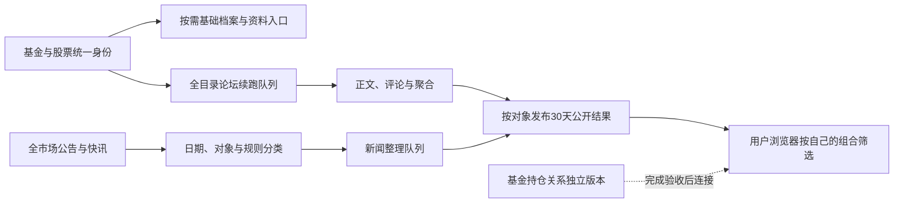

# 全市场对象与定时更新架构

更新：2026-11-25。实现基于已完成的公开基础信息，不依赖私人持仓，也不读取WorkBuddy正在生成的全市场持仓。

## 身份、基础信息与资料

当前来源目录28,405个基金代码，其中28,202个有详情、203个保留无详情档案；证券主档6,190个，角色与基金代码分开，共34,595个身份。不是34,595只独立存续产品或全球全部证券的监管验收分母。

`data/v10/objects.json`为检索身份，`entity-aliases.json`供后台匹配；`foundation/{funds|stocks}/{00..99}.json`按需加载。基金详情缺行业字段；名称主题、跟踪指数与行业配置分开。未知不填0，裸费率不当完整费用规则，原始成立日期不改称合同生效日。旧已核卡按非空字段合并，不覆盖丢失自动字段；来源观察与已核字段分开。

公共资料库现在可以为全部身份保留基础卡和公开入口。当前非新闻依据8条，另有历史行业统计原记录保留；法律与报告全文仍是少量已核资料，不称全市场全文齐全。只取得入口或标题的材料不能生成全文摘要。

## 新闻与论坛

新闻原主流程已使用全市场批量来源，修正后继续保留。全部读到的快讯保留；不能识别主体时进入待归属记录，不丢弃或强行贴到某股票。已匹配的股票、基金和多主体标签保留。规则分类与模型整理各自记录，模型不能改原文日期和身份标签。只有来源摘录的新闻才进入LLM队列；标题公告保留原标题。模型整理按输入哈希、模型与提示版本缓存，数字和引用必须属于该条材料。

论坛不再读取固定119对象。队列遍历统一目录，持久保存每个对象的日期窗口、页号、完成日期、重试与正文/评论状态；单轮时间上限只控制本轮工作量，不缩减身份范围。第一次从近30天窗口逐步补齐，此后按各对象已成功日期增量补漏。未处理和部分页不是零帖。来源拒绝停止并全局冷却24小时。

所有对象先推进列表，再处理原帖及一级/子评论。旧HTML正文和新React页面内原始JSON都支持，不执行网页脚本。严格超过5篇原帖才聚合；评论不增加帖数，阅读/评论量是采集时的累计值。20个合格历史日后才计算关注度Z值，标准差0仍未知。

评论接口真实样本报告31条，却在不同页和GET/POST请求中重复返回同5条。代码保留已取内容，记录部分覆盖，遇重复停止，避免假装采齐。公共正文/评论的隐藏、删除和来源限制无法用代码保证全量；模型只整理实际输入，保留分歧、条件与未核实状态。

## 运行、预算与存储

每日08:30北京时间运行公告、快讯及市场事实；论坛/模型队列每20分钟续跑，GitHub可能延迟。采集和连通检查使用同一串行组，日预算由当天账本读取，午夜按实际调用日切换，失败预留不清零。当前外置预算5元/日，耗尽后保存原文和待处理，不继续付费。

原文语料保存在仓库私有draft release的gzip检查点；不是公开发布的Release。Actions自带GITHUB_TOKEN授权，不需要新Key。上传后下载复核哈希，才推进公开指针；始终保护此前已提交的检查点，新的指针未提交也能恢复旧状态。最多保留当前与上一有效检查点，语料内只留滚动30天。恢复失败则不继续采集；检查点保存失败仍提交费用账本，不提交领先于缓存的队列状态。

Git中只更新基础信息、新闻、公开引用、最新统计与30天聚合结果。网页按对象加载，不在首屏下载全市场新闻与论坛原文。原始帖子、评论、账号/IP元数据、Key和私人组合不写入公开结果；原帖引用仍可追到公开网站。现有Git历史中的旧公共样例不是通过删除当前文件就被物理清除，未擅自重写Git历史。

[GitHub Release资源接口](https://docs.github.com/en/rest/releases/assets)支持二进制附件；[Release接口](https://docs.github.com/en/rest/releases/releases)对具有推送权限的调用者提供draft记录。代码对draft状态、哈希、路径和失败分支另做校验。

## 持仓连接接口

manifest中`holdingsInterface.enabled=false`，没有假装已经接入WorkBuddy正在跑的数据。接口要求fundCode、报告日asOf、完整性complete、来源source和holdings；每行weightPercent是占基金净资产的百分数。不得把PCF或指数权重替换真实持仓，不拼不同时点，也不把目录关系当分析资格。

后续拿到WorkBuddy已完成批次后，先核对其实际证券标识、报告期、分母与覆盖，再适配关系文件并启用接口。未知或境外证券需保留原标识和市场，不能因当前A股身份目录没有就删除。当前接口与原两只真实披露可独立运行，未持有基金也能按已接入公开关系查询关联新闻，不必加入私人组合。

默认/自选网页AI见《默认AI与自选AI配置》。当前新Key留空，代码和模拟响应验收不等于共享服务已经上线。
